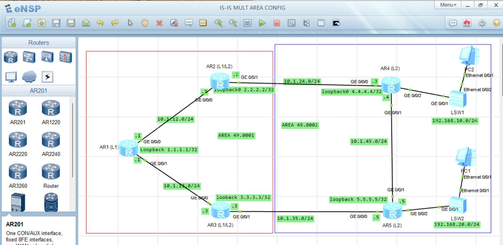
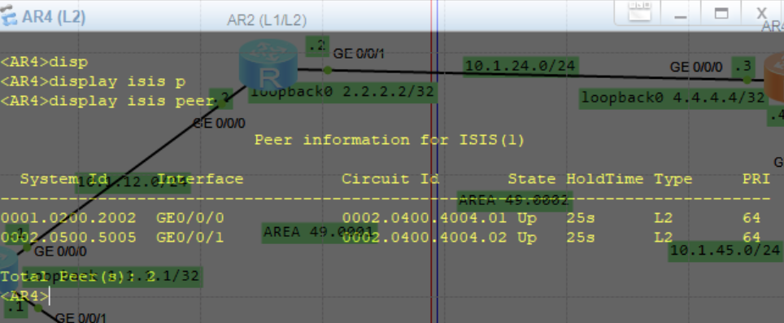
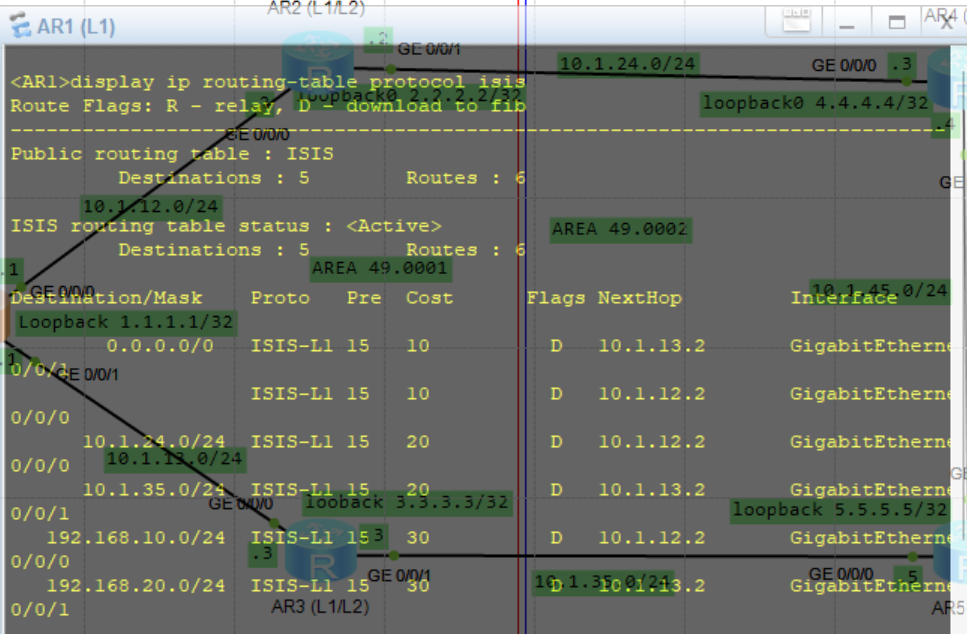
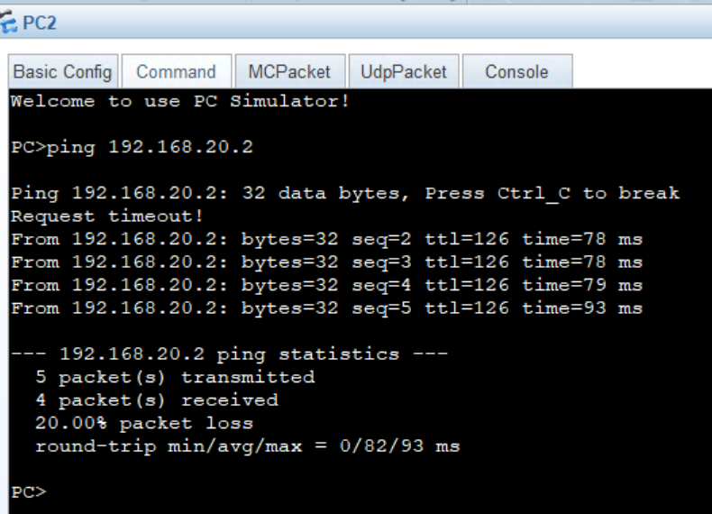

# IS-IS Multi-Area Lab (Huawei eNSP)

## Objective
Configure IS-IS in a multi-area design:
- **Area 49.0001:** AR1 (Level-1), AR2 and AR3 (Level-1-2)
- **Area 49.0002:** AR4 and AR5 (Level-2)

AR2 and AR3 connect the two areas. They use route leaking with an IP prefix filter so that only the PC subnets are imported from Level-2 into Level-1.

## Topology

## Folder Structure
- `Topology/` : eNSP project (.topo) and topology diagram
- `Configurations/` : configuration of each router, switch and PC
- `Verification/` : screenshots proving the lab works
- `Documentation/` : IP addressing and IS-IS design tables

## Verification
**IS-IS neighbors**

**IS-IS routing table**

**Connectivity test**

## Tools
Huawei eNSP, Git and GitHub.
